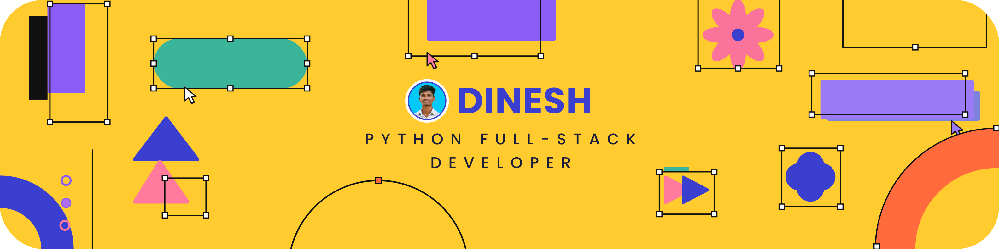

  

<h1 align="center">D I N E S H</h1>
<h3 align="center">Python Full-Stack Developer • UI/UX Designer</h3>

  <code>Python</code> • <code>Django</code> • <code>React</code> • <code>JavaScript</code> • <code>MySQL</code> • <code>UI/UX Design</code>

<h3 align="center"><i>Building User-Centric Web Applications</i></h3>

  
  
  
  
  
  
  

---

<h2 align="center">
  
</h2>

<i>Code that works. Design that feels right.</i>

> 💻 I build web applications using **Python**, **Django**, **React**, **JavaScript** and **MySQL**, with a strong focus on the **design and usefulness** of every solution I deliver.

> 🎨 My interests include **Full-Stack Development**, **UI/UX Design**, **Frontend & Backend Development**, **REST APIs**, **Databases**, and creating **responsive, user-friendly websites**.

> 🚀 I enjoy working on project ideas, exploring the newest technologies, solving different kinds of problems, and continuously improving my **technical and design skills**.

---

<h2 align="center">
  
</h2>

  I'm looking for a job position as a <b>Python Full-Stack Developer</b> and <b>UI/UX Designer</b>.

<i>Let's build something great together. 📩</i>

